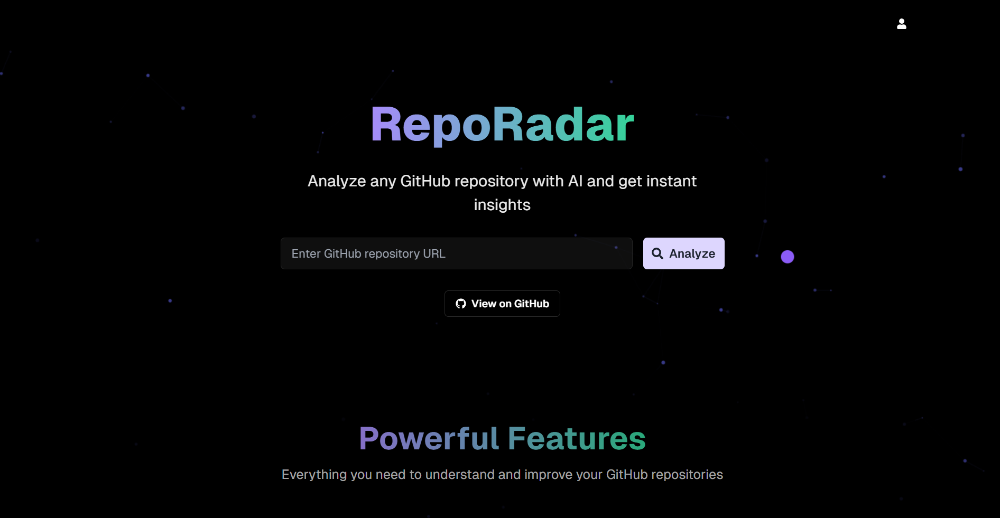
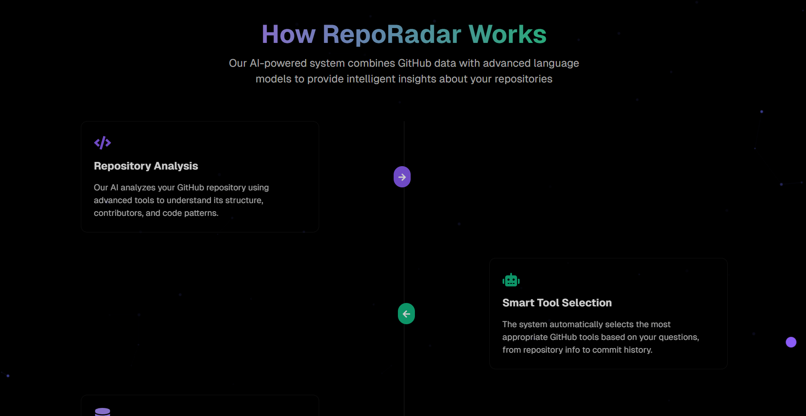
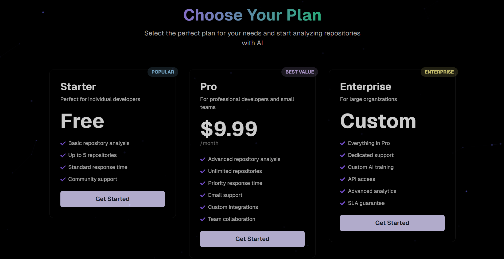
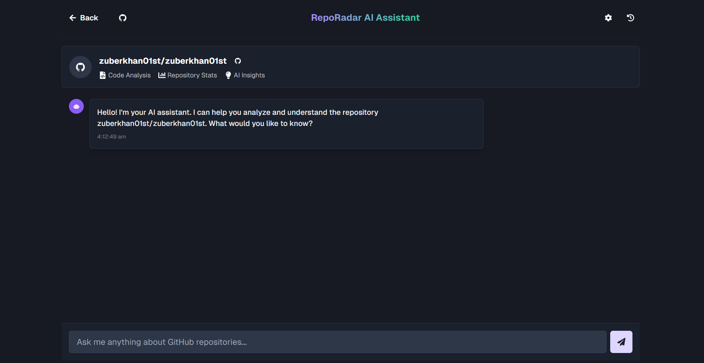

# RepoRadar

AI-powered GitHub repository analysis. Point it at a repository, get a structured
breakdown of its structure, dependencies and risks, then ask questions about the
code in plain English.

## Screenshots

<div align="center">
  
  <p><em>RepoRadar interface</em></p>
</div>

<div align="center">
  
  <p><em>Key features and capabilities</em></p>
</div>

<div align="center">
  
  <p><em>Interactive chat interface</em></p>
</div>

<div align="center">
  
  <p><em>Advanced analysis and insights</em></p>
</div>

> Screenshots are from the original project by [zuberkhan01st](https://github.com/zuberkhan01st).

## Features

- **Natural language interaction** — chat with a repository using plain English
- **Code analysis** — structure, patterns and dependency insight
- **Actionable recommendations** — AI-sourced suggestions for improvement
- **Security review** — dependency and vulnerability surfacing
- **Interactive UI** — responsive, animated, keyboard and mouse friendly

## Architecture

RepoRadar is a three-service system:

| Service | Stack | Role |
| --- | --- | --- |
| `frontend/` | Next.js 14 (App Router), React, TypeScript, Chakra UI, Tailwind CSS, Framer Motion | The web client — landing page, analysis view, chat, auth, subscription plans and the full legal-page set. |
| `Backend/` | Node.js, Express, Mongoose, Swagger (OpenAPI 3), Brevo | REST API — GitHub integration, repository analysis orchestration, AI chat, auth, email delivery. |
| `git_analyzer/` | Python, Flask | Repository-cloning and static analysis service invoked by the backend. |

## Getting started

### Prerequisites

- Node.js 18+
- Python 3.10+
- A MongoDB instance (local or Atlas)
- A GitHub personal access token with read access to repository contents
- A Groq API key for LLM inference
- A Brevo account for transactional email

### 1. Backend

```bash
cd Backend
npm install
cp .env.example .env      # Windows: copy .env.example .env
npm start
```

The API serves on `http://localhost:5000` with OpenAPI docs at
`http://localhost:5000/api-docs`.

### 2. Analyzer service

```bash
cd git_analyzer
python -m venv .venv
# Windows: .venv\Scripts\activate
# macOS/Linux: source .venv/bin/activate
pip install -r requirements.txt
python run.py
```

### 3. Frontend

```bash
cd frontend
npm install
cp .env.example .env.local   # Windows: copy .env.example .env.local
npm run dev
```

The app runs on `http://localhost:3000`.

## Environment variables

**`Backend/.env`**

| Variable | Required | Description |
| --- | --- | --- |
| `NODE_ENV` | no | Runtime mode. Defaults to `development`. |
| `PORT` | no | API port. Defaults to `5000`. |
| `MONGO_URI` | yes | MongoDB connection string. The database name must match `DB_NAME` in `services/githubService.js` (`reporadar`) or analysis data will land in a different database. |
| `JWT_SECRET` | yes | Secret used to sign auth tokens. |
| `GITHUB_TOKEN` | yes | Fine-grained PAT with read access to repository contents. |
| `GROQ_API_KEY` | yes | Groq API key for LLM inference. |
| `BREVO_API_KEY` | yes | Brevo API key for transactional email. |
| `BREVO_EMAIL_USER` | yes | Brevo account login used as the sender. |
| `EMAIL_USER` | yes | SMTP account for the fallback email transport. |
| `EMAIL_PASS` | yes | SMTP password for the fallback email transport. |

**`frontend/.env.local`**

| Variable | Required | Description |
| --- | --- | --- |
| `NEXT_PUBLIC_API_URL` | no | Base URL of the API. Defaults to `http://localhost:5000`. |

## Usage

1. Enter a GitHub repository URL
2. Wait for the initial analysis
3. Ask the assistant questions about the code
4. Review the generated insights and recommendations

## Contributing

Contributions are welcome.

1. Fork the repository
2. Create a feature branch (`git checkout -b feature/your-feature`)
3. Commit your changes (`git commit -m 'Add your feature'`)
4. Push to the branch (`git push origin feature/your-feature`)
5. Open a pull request

## License

MIT — see [LICENSE](LICENSE).

Copyright (c) 2025 zuberkhan01st (original project) · Copyright (c) 2026 Mohit Budhani.

## Credits

RepoRadar began as the open-source project
[zuberkhan01st/RepoRadar](https://github.com/zuberkhan01st/RepoRadar), released
under the MIT License. This repository is a maintained continuation of that
project — the original author's copyright is retained in [LICENSE](LICENSE).

Built on [Next.js](https://nextjs.org/), [Chakra UI](https://chakra-ui.com/),
[Framer Motion](https://www.framer.com/motion/), the
[GitHub REST API](https://docs.github.com/en/rest), [MongoDB](https://www.mongodb.com/),
[Groq](https://groq.com/) and [Brevo](https://www.brevo.com/).

## Contact

Open an issue at [github.com/mohit670-git/RepoRadar](https://github.com/mohit670-git/RepoRadar/issues).
